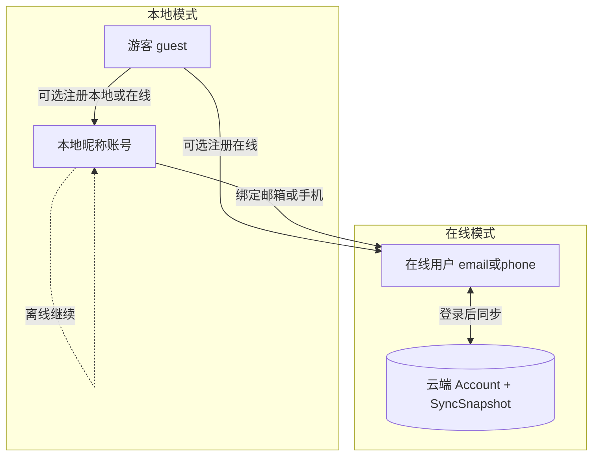

# 在线账号功能设计

> 状态：设计稿（待评审）  
> 范围确认：邮箱/手机号登录；首版仅云端登录 + 进度同步；**兼容已有本地登录用户**  
> 日期：2026-10-12

## 1. 目标与非目标

### 目标（首版）

1. 用户可用 **邮箱或手机号 + 密码** 注册/登录在线账号。
2. 学习进度在多设备间 **自动同步**（登录后拉取；进度变更后上传）。
3. **已有本地昵称账号** 可继续离线使用；并可 **绑定在线身份后上传进度**，不丢本地数据。
4. 游客模式保留（「开始学习」），不强制注册。

### 非目标（首版不做）

- 短信/邮件验证码登录（可后续加；首版密码制）
- 微信 / Apple 第三方登录
- 改密找回、账号注销的完整运营后台（接口可预留，UI 可后置）
- 冲突时的人工三方合并 UI（首版用确定性合并规则）
- 学习行为遥测上云做分析看板（首版只同步「续学所需」数据）

## 2. 现状基线

| 能力 | 现状 |
|------|------|
| 本地账号 | 昵称 + 加盐 SHA-256，Hive `users` / `auth_session` |
| 游客 | `userKey=guest`，进度隔离 |
| 进度/奖励/轨道 | Hive：`lesson_progress`、`reward_attempts`、`app_settings` |
| 多设备 | 手动备份 JSON v2（进度+奖励；缺 learning_records / track） |
| 云端 | 无 |

关键代码：[`lib/app/auth_controller.dart`](../lib/app/auth_controller.dart)、[`lib/core/services/backup_service.dart`](../lib/core/services/backup_service.dart)、[`lib/data/sources/progress_store.dart`](../lib/data/sources/progress_store.dart)。

## 3. 总体方案

采用 **双模式身份**：

- **本地模式**：行为与现网一致，无网络也可学。
- **在线模式**：以服务端 `accountId` 为权威身份；本机用 `userKey = online:<accountId>` 隔离 Hive 槽位。
- **兼容路径**：本地昵称账号 →「绑定在线账号」→ 上传当前进度到云端 → 之后以在线身份登录各设备。

### 后端选型（已定）

自建轻量 **HTTPS API + PostgreSQL**（或兼容的托管 Postgres），不绑定 Firebase（国内可达性差）。

首版推荐部署形态：

- API：Dart Shelf / Node Fastify（二选一实施时定；推荐 **Dart Shelf** 与 App 同语言）
- DB：PostgreSQL
- 认证：自管 JWT（access 短时 + refresh 长时），密码 **argon2id**（服务端），传输全程 TLS

客户端仅依赖 `http` + 安全存储 refresh token（`flutter_secure_storage`）。

## 4. 身份模型

### 4.1 在线账号（服务端）

| 字段 | 说明 |
|------|------|
| `account_id` | UUID |
| `email` | 可空，与 phone 至少其一 |
| `phone` | 可空，E.164 |
| `password_hash` | argon2id |
| `display_name` | 默认取邮箱前缀或「学员」；可来自本地昵称 |
| `created_at` / `updated_at` | |

约束：`email`、`phone` 各自唯一（允许多个空，用部分唯一索引）。

### 4.2 客户端会话

扩展 `AuthState`：

| 字段 | 说明 |
|------|------|
| `userKey` | `guest` / 本地昵称 / `online:<accountId>` |
| `authMode` | `guest` \| `local` \| `online` |
| `accessToken` | 仅 online，内存 + 可选短期缓存 |
| `refreshToken` | 仅 online，安全存储 |
| `linkedOnline` | 本地账号是否已绑定过（本地标记） |

本地 `User` Hive 模型增加可选字段（向后兼容 Adapter）：

- `onlineAccountId`（String?）
- `onlineBoundAt`（int?）

未升级的旧记录读取时视为未绑定。

### 4.3 登录入口（UI）

欢迎页保持：

1. **开始学习** → 游客  
2. **登录 / 注册** → 进入账号页，增加分段：

- Tab「在线账号」：邮箱或手机号 + 密码（注册/登录）  
- Tab「本地账号」：现有昵称密码（兼容）

抽屉展示：

- 游客 / 本地账号xxx / 在线账号（掩码邮箱或手机）  
- 本地未绑定：显示「绑定在线账号，多设备同步」  
- 在线：显示「同步状态 / 上次同步时间」

## 5. 同步数据范围

首版同步包 `SyncSnapshot`（version=1）：

| 字段 | 来源 | 说明 |
|------|------|------|
| `progress[]` | `lesson_progress` | 与 backup v2 同结构 |
| `rewards[]` | `reward_attempts` | attemptId → unitId |
| `track` | `app_settings` | 当前课程轨 |
| `clientUpdatedAt` | 客户端时钟 | 合并参考 |
| `schemaVersion` | 常数 1 | |

**首版不同步**（可后续加）：`learning_records` 事件流（体积大、非续学刚需）。错题复习仍以本机为准；多设备错题不保证一致。

服务端表建议：

- `accounts`
- `sync_snapshots`：`account_id` PK，`payload jsonb`，`server_updated_at`，`client_updated_at`

每账号只保留 **一份最新快照**（整包替换 + 合并规则在服务端或客户端执行后上传）。

## 6. 合并规则（确定性，无弹窗）

对同一 `lessonId` 的进度记录：

1. `completed == true` 优先于 `false`  
2. 双方都完成：取 **较高 `score`**；同分取较大 `completedAt`  
3. 未完成记录：取较大 `correctCount/totalCount` 表征的进度（若有），否则保留较新 `completedAt`

奖励：`attemptId` 并集（跳过重复 id）。  
轨道：取 `clientUpdatedAt` 较新一侧的 `track`。

拉取后写本地 Hive；上传前用「本地 ∪ 云端」合并结果再 PUT。

## 7. 兼容本地用户的关键流程

### 7.1 纯本地用户（不绑定）

- 行为不变：离线登录、备份/恢复 JSON 仍可用。  
- 不调用云 API。

### 7.2 本地 → 绑定在线（升级）

前提：当前会话为本地昵称账号（非游客）。

1. 用户输入邮箱或手机号 + 密码，选择「注册并绑定」或「登录并绑定」。  
2. 若云端账号已有进度：按 §6 与 **当前本地进度** 合并。  
3. 写回本地槽位：将会话切换为 `online:<accountId>`，并把原本地 `nickname|*` 进度 **复制/迁移** 到 `online:<accountId>|*`（迁移后保留原本地槽位只读副本，避免误删；或标记 `migratedTo`）。  
4. 本地 `User.onlineAccountId = accountId`。  
5. 上传合并后的快照。

### 7.3 游客 → 在线

- 注册/登录在线账号后，**询问是否导入当前游客进度**（单次确认对话框，属于产品必要交互，不算「冲突三方合并」）。  
- 选是：合并 guest → online 槽位后上传；选否：online 从云端拉取或空档开始。

### 7.4 已在线用户换机

1. 登录 → 拉快照 → 写入 `online:<id>` 槽位 → 进入学习路径。  
2. 之后每次打开 App：若有网，后台 `pull → merge → push`（失败不阻断学习，提示「同步失败，稍后再试」）。

## 8. API 草案

Base：`https://api.<domain>/v1`

| 方法 | 路径 | 说明 |
|------|------|------|
| POST | `/auth/register` | `{email?, phone?, password, displayName?}` → tokens + account |
| POST | `/auth/login` | `{email?, phone?, password}` → tokens + account |
| POST | `/auth/refresh` | `{refreshToken}` → access |
| POST | `/auth/logout` | 作废 refresh（可选） |
| GET | `/sync` | Bearer；返回最新 snapshot 或 204 |
| PUT | `/sync` | Bearer；body=SyncSnapshot；服务端存合并前由客户端合并完毕的整包 |

错误码统一 JSON：`{code, message}`。  
密码错误不区分「账号不存在/密码错」可对枚举做轻微模糊（防枚举可后置）。

## 9. 客户端架构改动要点

| 模块 | 改动 |
|------|------|
| `User` / Adapter | 增加 online 绑定字段；typeId 保持 1，字段扩展 |
| `AuthController` | `authMode`、token 生命周期、online login/register/bind |
| `CloudAuthApi` / `SyncApi` | 新建，封装 HTTP |
| `SyncService` | pull/merge/push；复用并扩展 BackupService 的序列化 |
| `providers.dart` | online 时 `userKey` 驱动各 Store |
| 登录 UI | 在线/本地 Tab；抽屉绑定入口 |
| 配置 | `kApiBaseUrl`（flavor：debug/prod） |

进度写入路径（`ProgressRepository.save` / 奖励领取）在 online 模式下 **防抖上传**（如 2s debounce + App 回前台/退出时 flush）。

## 10. 安全

- 仅 HTTPS；证书钉扎可后置。  
- Refresh token 存 `flutter_secure_storage`；logout 清除。  
- 服务端密码 argon2id；本地账号仍用现有 SHA-256（不迁服务端）。  
- 备份 JSON 继续视为机密；在线模式不再依赖把 hash 传到第二台设备。  
- 不在日志打印 token / 密码。

## 11. 分阶段实施

### Phase A — 服务端骨架 + 在线注册登录

- DB + `/auth/*` + 客户端在线 Tab  
- 本地 Tab 保持  
- 尚不同步

### Phase B — 同步

- `SyncSnapshot` + GET/PUT `/sync`  
- 登录后 pull；进度变更 debounce push  
- 合并规则单测

### Phase C — 兼容绑定

- 本地「绑定在线账号」  
- 游客导入确认  
- 抽屉同步状态  
- 回归：纯本地、备份恢复、游客路径

### Phase D（可选后续）

- 验证码登录、找回密码、learning_records 同步、账号注销

## 12. 测试要点

- 在线注册/登录/断网降级  
- 合并：一侧完成一侧未完成 → 保留完成  
- 本地绑定后换设备可见进度  
- 未绑定本地用户：无网络请求  
- 备份 v2 对纯本地仍可用  
- Adapter 扩展后旧 Hive 用户可读

## 13. 验收标准

1. 新用户可用邮箱或手机号注册并在第二台设备登录看到同一进度。  
2. 旧版升级上来的本地昵称用户：不绑定则体验与现在一致；绑定后进度上云且本机不丢课。  
3. 无网时可继续用本地/已缓存的在线槽位学习；恢复网络后自动同步。  
4. 游客仍可零注册开用。

## 14. 待你确认后即可开工的默认项

已按回复锁定：

- 登录因子：邮箱 **或** 手机号 + 密码  
- 首版目标：云端登录 + 进度同步  
- 兼容本地已登录用户（绑定升级）

实施时默认：

- 自建 API + Postgres + JWT  
- 同步含 progress / rewards / track  
- 合并规则见 §6  
- 不同步 learning_records（首版）

---

## 15. Phase A 实施状态（2026-10-12）

**服务端（`server/`，纯 Dart 包 `global_village_server`）已实现并验证：**

- `POST /v1/auth/register|login|refresh|logout`，统一错误 JSON `{code,message}`
- argon2id 密码哈希（OWASP 参数 m=19MiB/t=2/p=1），JWT HS256（access 15 分钟 / refresh 30 天）
- `AccountsRepo` 抽象 + Postgres 实现（部分唯一索引、自动建表）+ 内存实现（`STORAGE=memory` 或缺省 `DATABASE_URL` 时本地开发）
- 配置：`PORT` / `JWT_SECRET` / `DATABASE_URL` / `STORAGE`
- 11 项 API 测试 + 内存模式真实启动冒烟（注册→登录→刷新→错误密码 401）全部通过

**客户端已实现并验证：**

- `AuthState` 增加 `mode`（guest/local/online）、`accessToken`、`displayName`；在线会话 userKey 为 `online:<accountId>`，与本地/游客槽位隔离
- `User` Hive 模型新增可选 `onlineAccountId`/`onlineBoundAt`（旧数据读取兼容）；会话显示名随 session 持久化
- `CloudAuthApi`（错误码/文案透传，UTF-8 解码）+ `SecureTokenStore`（flutter_secure_storage；测试用 MemoryTokenStore）；API 基址用 `--dart-define=API_BASE_URL=...` 覆盖，默认 `http://localhost:8787/v1`
- 登录/注册页改为「在线账号 | 本地账号」分段切换；在线表单为"邮箱或手机号 + 密码"（含 `@` 判邮箱）；侧栏显示在线账号名与"在线账号"标识
- 重启后在线会话用 refresh token 静默换新 access token，断网静默降级保持本地会话
- 退出登录：在线会话先调用 `/auth/logout`（幂等）并清除本地 token
- 9 项在线鉴权测试通过；全量 98 项测试通过；analyzer 零问题

**尚未实施（Phase D）：** 邮箱验证码、忘记密码、注销、限流与审计。本地 Tab 与游客入口保持不变，未配置服务端时不影响现有功能。

**部署（本地测试 + 生产 VPS）：** 见 [`在线账号服务端部署.md`](./在线账号服务端部署.md)。仓库已含 `server/Dockerfile`、`docker-compose.yml`、`.env.example`、`Caddyfile.example` 与 `GET /v1/health`。

---

## 16. Phase B/C 实施状态（2026-10-12）

**Phase B 进度同步已实现并验证：**

- 服务端：`GET/PUT /v1/sync`（Bearer access token 鉴权），每账号一份整包快照；`sync_snapshots` 表（jsonb payload + client_updated_at）；`baseClientUpdatedAt` 乐观并发，不一致返回 409 `sync_conflict`
- 客户端 `SyncSnapshot`（schemaVersion=1）：progress（按 lessonId）、rewards（attemptId→lessonId）、track（selected + perLanguage + updatedAt）
- `SyncMerger` 合并规则（§6）：完成优先；双完成取高分（同分取较新 completedAt）；双未完成取正确数多者；奖励 attemptId 并集；轨道取 updatedAt 较新一侧
- `SyncService`：登录/会话恢复后 pull→merge→push；首次同步（云端 204）直接上传本地；进度回写/奖励入账/轨道切换 2 秒防抖上传；401 自动刷新 token 重试一次；409 重新拉合并一次；合并写回 Hive 后刷新路径与轨道 UI
- 断网/失败：状态置 failed（抽屉提示"同步失败，稍后再试"），不阻断学习；下次变更或启动时再同步
- 抽屉在线账号行显示同步状态（同步中 / 上次同步 HH:mm / 失败）

**Phase C 兼容绑定已实现并验证：**

- 本地账号：抽屉显示"绑定在线账号，多设备同步"→ 底部面板（邮箱或手机号 + 密码，注册并绑定 / 登录并绑定）；成功后原本地槽位复制到 `online:<accountId>` 槽位并保留只读副本，`User.onlineAccountId/onlineBoundAt` 落库，随后 pull→merge→push 上云
- 游客升级：注册/登录在线账号后若本机有游客进度，首页单次确认对话框（导入 / 不导入）；导入=复制 guest 槽位后合并上传
- 换机：登录即拉取合并；session 恢复静默刷新 token 后同样触发同步

**验证：** 服务端 16 项测试 + 真实启动冒烟（首拉 204 → push → 取回 → 过期 base 409）；客户端合并规则/快照序列化/pull-merge/copySlot/绑定/游客导入共 12 项新测试；全量 110 项测试通过；两端 analyzer 零问题。
