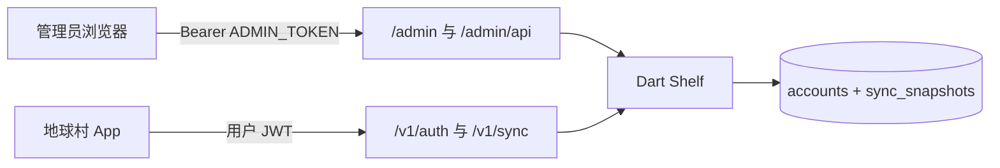

# 服务器后台管理设计

> 状态：设计稿（待评审）  
> 范围：在现有 Dart Shelf 账号服务上增加仅管理员可用的后台。查看账号与同步快照，并可停用、重置密码、删除账号及其同步数据。  
> 日期：2026-10-16  
> 关联：[在线账号功能设计.md](在线账号功能设计.md)、[在线账号服务端部署.md](在线账号服务端部署.md)

## 1. 目标与非目标

### 目标（第一版）

1. 管理员能列出在线账号，并查看该账号的同步快照（进度、奖励、线路、同步时间）。
2. 能停用 / 恢复账号。停用后登录、刷新和同步立即失败。
3. 能由管理员设置新密码。旧 token 立即失效。
4. 能删除账号，并删除该账号的 `sync_snapshots`。手机上的 Hive 进度不删。

### 非目标

- 课程内容编辑
- 学习行为遥测看板
- 短信 / 邮件验证码、用户自助找回密码
- 多管理员角色与操作审计日志
- 另起进程或引入前端构建工程

## 2. 现状

服务在 [`server/`](../server/)，Dart Shelf，默认端口 **8787**。

| 能力 | 现状 |
|------|------|
| 用户接口 | `GET /v1/health`，`POST /v1/auth/register\|login\|refresh\|logout`，`GET/PUT /v1/sync` |
| 账号表 | `accounts`：`account_id`、`email`、`phone`、`password_hash`、`display_name`、`created_at`、`updated_at` |
| 同步表 | `sync_snapshots`：每账号一行，`payload jsonb`（`schemaVersion=1` 的 progress / rewards / track） |
| 令牌 | HS256 JWT，无服务端作废表。access 约 15 分钟，refresh 约 30 天。logout 只清客户端 |
| 后台 | 无 |

进度在手机上是 Hive `lesson_progress`，键为 `userKey|lessonId`。在线账号的 `userKey` 为 `online:<accountId>`。云端只保存整包 JSON，不按课拆行。

## 3. 总体方案

后台挂在同一个 `global_village_server` 进程上。Shelf 直接返回一页静态 HTML，接口与页面同源。

- 页面：`GET /admin`
- 接口：`/admin/api/*`
- 本地：`http://127.0.0.1:8787/admin`
- 经 Cloudflare 临时隧道时：`https://<隧道主机>/admin`。隧道转发的是整个 8787，因此 **必须** 设置 `ADMIN_TOKEN`，否则不注册这些路由。

## 4. 鉴权

环境变量 `ADMIN_TOKEN`，与用户 `JWT_SECRET`、用户 JWT 无关。

| 条件 | 行为 |
|------|------|
| `ADMIN_TOKEN` 未设置或为空 | `/admin` 与 `/admin/api/*` 一律 **404**，响应体不提示后台存在 |
| 已设置，但请求没有匹配的 Bearer | **401** |
| Bearer 与 `ADMIN_TOKEN` 常量时间比较相等 | 放行 |

比较使用与密码校验相同的常量时间比较，避免按长度或前缀提前返回。

页面流程：

1. 打开 `/admin`，HTML 本身不包含口令。
2. 管理员输入口令，前端以 `Authorization: Bearer <口令>` 调列表接口。
3. 成功后把口令放进 `sessionStorage`（键名如 `gv_admin_token`）。关闭标签页即丢。
4. 不把口令放进 URL、localStorage 或用户 JWT。

管理接口的响应 **不得** 包含 `password_hash`。

用户 access / refresh token 调用 `/admin/api/*` 一律 401。管理口令也不能当作 `/v1` 的用户 token。

## 5. 停用与改密立即生效

现有 JWT 无状态，只改库里的密码哈希不能使已发出的 token 失效。账号表增加两列（Postgres 用 `ALTER TABLE`；内存仓储用同等字段）：

| 列 | 说明 |
|----|------|
| `disabled_at timestamptz` | 空表示可用；非空表示停用时间 |
| `credential_version int NOT NULL DEFAULT 1` | 重置密码时加 1 |

签发 access 与 refresh 时增加声明 `cv`（值为当时的 `credential_version`）。现有声明保持 `sub`、`typ`。

以下路径在验签之后再查库：

- `POST /v1/auth/login`：密码正确但 `disabled_at` 非空 → 401，文案与「账号不存在或密码错误」相同，避免用停用状态枚举账号
- `POST /v1/auth/refresh`
- `GET /v1/sync`、`PUT /v1/sync`

后三条：账号不存在、`disabled_at` 非空，或 token 的 `cv` 与库中 `credential_version` 不一致 → **401**。这样停用和改密不必等 access token 自然过期。

注册成功时 `credential_version = 1`，签发的 token 带 `cv=1`。旧 token（尚无 `cv`）在这两列上线后视为不匹配，用户需重新登录。这是可接受的一次性中断，因为当前只有联调账号。

内存仓储（`STORAGE=memory`）实现同一字段和同一判断，供 `server/test` 覆盖。

## 6. 管理接口

均要求第 4 节的管理员 Bearer。错误体与现有接口一致：`{ "code", "message" }`。

### 6.1 列表

`GET /admin/api/accounts`

按 `created_at` 倒序。每项：

| 字段 | 说明 |
|------|------|
| `accountId` | UUID |
| `email` / `phone` | 可空 |
| `displayName` | |
| `createdAt` / `updatedAt` | ISO-8601 |
| `disabledAt` | 空表示可用 |
| `credentialVersion` | 当前版本，便于核对改密是否生效 |
| `serverUpdatedAt` | 该账号 `sync_snapshots.server_updated_at`，从未同步则为 null |
| `lessonCount` | `payload.progress` 的键数量 |
| `device` | 最后一次上传的设备 `{platform, osVersion, appVersion, installId}`，旧客户端可能为 null |

### 6.2 详情

`GET /admin/api/accounts/:id`

账号不存在 → 404。正文含列表中的账号字段，另加：

| 字段 | 说明 |
|------|------|
| `clientUpdatedAt` | 快照内的毫秒时间戳；无快照则为 null |
| `device` | 同列表；`account.device` 便于详情直接展示 |
| `track` | `{ selected, perLanguage, updatedAt }`，无则为 `{}` |
| `rewards` | `attemptId → lessonId` |
| `progress` | 按课号前缀分组后的课列表，见下 |

分组规则（与现有课号一致）：

| 分组 | 课号 |
|------|------|
| `english` | 不以 `sa_`、`zh_` 开头（当前英语入门为 `u1l1` 这类） |
| `sanskrit` | `sa_` 开头 |
| `chinese` | `zh_` 开头 |
| `other` | 以上都不符合时兜底，避免新前缀被悄悄丢掉 |

每课：`lessonId`、`completed`、`score`、`correctCount`、`totalCount`、`completedAt`（毫秒，可空）。组内按 `lessonId` 字典序。

### 6.3 停用与恢复

- `POST /admin/api/accounts/:id/disable`：写入 `disabled_at = now()`。已停用则保持原时间，返回 200。
- `POST /admin/api/accounts/:id/enable`：把 `disabled_at` 置空。

不改 `credential_version`。已发出的 token 因停用检查失败；恢复后，版本仍匹配的旧 token 可以继续用到过期。若要连旧 token 一起作废，管理员应同时重置密码。

### 6.4 重置密码

`POST /admin/api/accounts/:id/password`

正文：`{ "password": "..." }`。少于 6 位 → 400 `weak_password`。

成功时：

1. 用现有 argon2id 写入新 `password_hash`
2. `credential_version` 加 1，`updated_at = now()`
3. 200 正文只含 `accountId` 与新的 `credentialVersion`

新密码只出现在管理员刚提交的请求里，**响应不再回显**。页面在提交前用确认框展示管理员自己输入的密码，提交成功后清空输入框。

### 6.5 删除

`DELETE /admin/api/accounts/:id`

顺序：先删 `sync_snapshots` 中该 `account_id` 的行，再删 `accounts`。账号不存在 → 404。成功 → 204。

不删除手机本地 Hive。该 `accountId` 再次登录会失败；本地槽位 `online:<accountId>` 留在设备上，直到用户卸载或换账号。

页面删除前要求输入该账号的手机号或邮箱（有哪个对哪个），与详情一致才发请求。

## 7. 页面

单页 HTML，由 `GET /admin` 返回，`Content-Type: text/html; charset=utf-8`。不使用打包工具，样式写在页内。

区块：

1. 口令输入与「进入」。401 时提示口令错误，不跳转。
2. 账号表：手机 / 邮箱、昵称、注册时间、停用状态、进度课数、最近同步时间（下方灰色小字为设备摘要：平台 · App 版本）。行点击打开详情。
3. 详情：同步信息（最近同步、客户端时间、设备平台/系统版本/App 版本/安装 ID）、三个分组的进度表、奖励条数、线路 `selected` 与 `perLanguage`。
4. 操作：停用或恢复、设置新密码、删除。停用可一键；设置密码与删除必须二次确认。

时间在页面上显示为本地时区。接口仍用 UTC。

## 8. 部署注意

[`server/.env.example`](../server/.env.example) 增加 `ADMIN_TOKEN=`，并注明：留空则后台不启用。

[`server/dev-db.sh`](../server/dev-db.sh) 与 [`server/dev-tunnel.sh`](../server/dev-tunnel.sh) 若环境中已有 `ADMIN_TOKEN`，原样传给 `dart run`。脚本不生成默认口令。

生产与临时隧道共用同一端口。隧道开启期间，知道 URL 的人可以访问 `/admin` 登录页；没有 `ADMIN_TOKEN` 时该路径不存在。口令应使用长随机串（例如 `openssl rand -hex 32`），不要用 `dev-local`。

Postgres 的 `5433`（或容器内 `5432`）仍然只给本机或容器网络，不映射到公网。

## 9. 测试要点

在 `server/test` 用内存仓储覆盖：

- 未设置 `ADMIN_TOKEN` 时 `GET /admin` 与 `GET /admin/api/accounts` 为 404
- 错误 Bearer 为 401；正确 Bearer 能列出账号且 JSON 无 `passwordHash`
- 停用后 `login`、`refresh`、`GET /v1/sync` 为 401；`enable` 后使用匹配 `cv` 的 token 恢复
- 重置密码后旧 access / refresh 为 401，新密码可登录且 `cv` 增加
- 删除后账号 404，同步快照不存在；再次用原密码登录为 401

## 10. 实施时要改的代码（本设计不实现）

| 位置 | 改动 |
|------|------|
| [`server/lib/accounts_repo.dart`](../server/lib/accounts_repo.dart) | `Account` 增加 `disabledAt`、`credentialVersion` |
| [`server/lib/postgres_accounts_repo.dart`](../server/lib/postgres_accounts_repo.dart) | 迁移两列；列表、更新、删除 |
| [`server/lib/inmemory_accounts_repo.dart`](../server/lib/inmemory_accounts_repo.dart) | 同等行为 |
| [`server/lib/auth_service.dart`](../server/lib/auth_service.dart) | JWT 写入并读出 `cv` |
| [`server/lib/api.dart`](../server/lib/api.dart) | 登录 / 刷新 / 同步查停用与版本；挂载 `/admin` |
| [`server/lib/sync_repo.dart`](../server/lib/sync_repo.dart) | 按账号删除快照；列表需要的同步时间与课数可由账号查询一并取出 |
| 新建管理页面与路由 | 静态 HTML + `/admin/api/*` |
| [`server/.env.example`](../server/.env.example) | `ADMIN_TOKEN` |
| [`server/test/`](../server/test/) | 第 9 节用例 |
